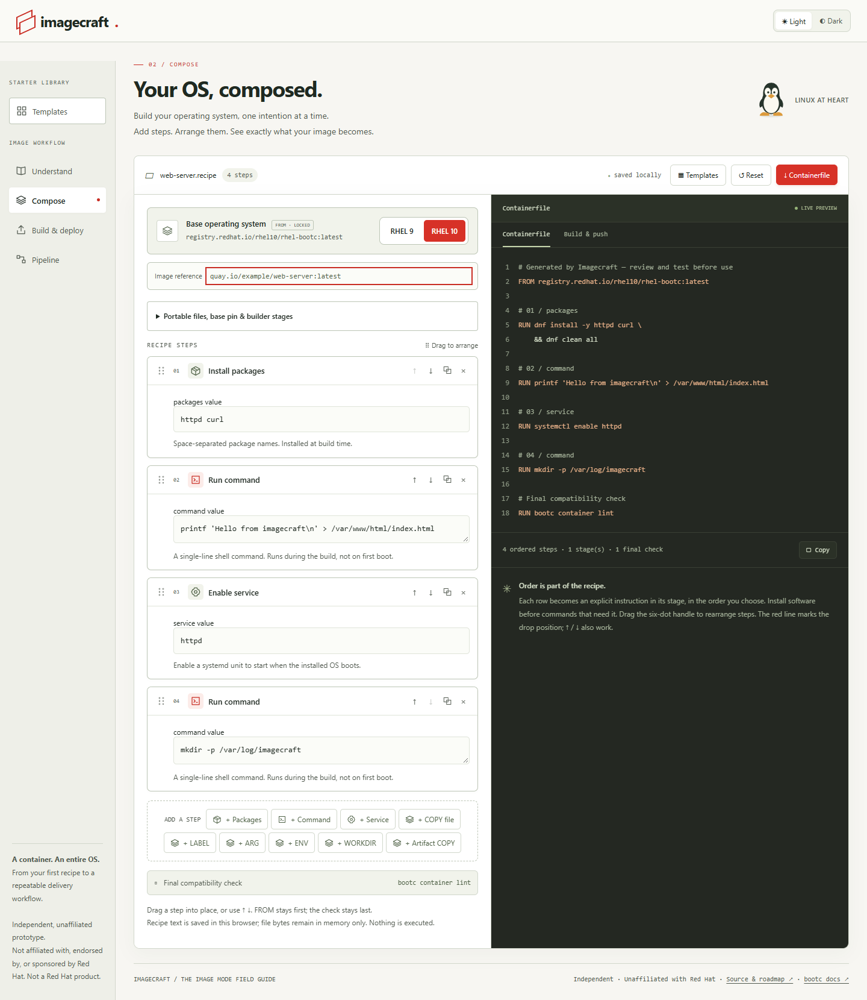
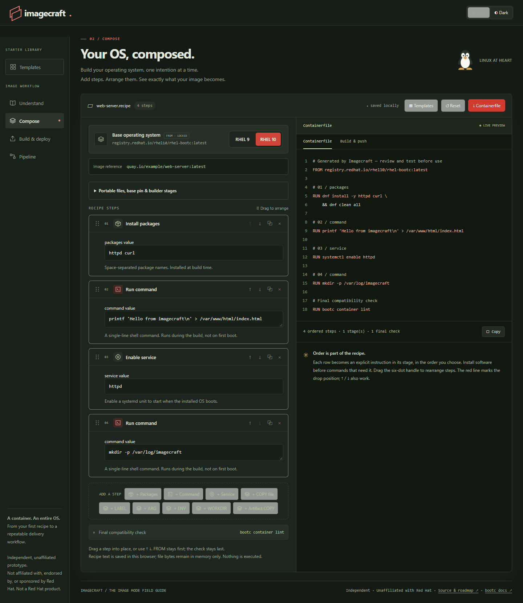
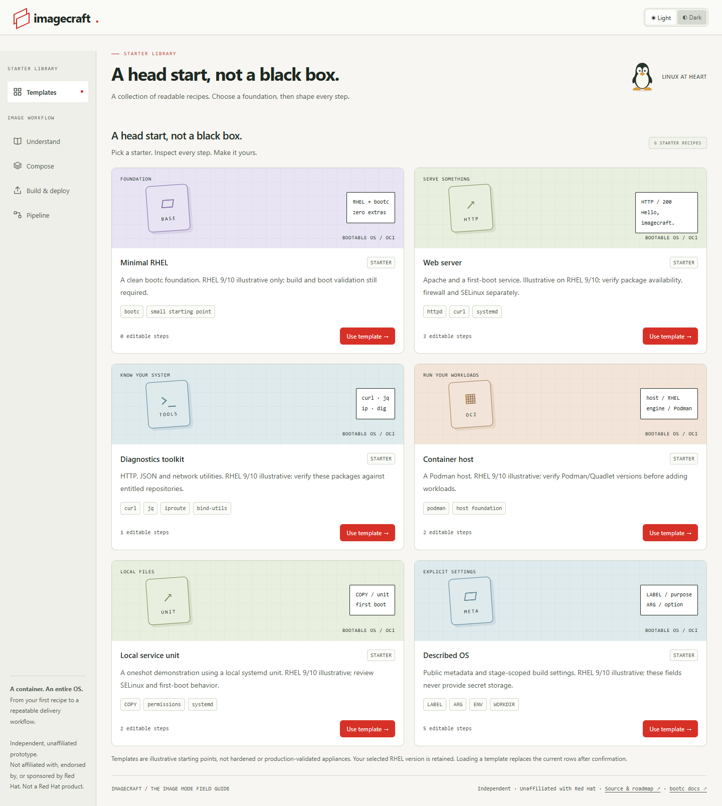
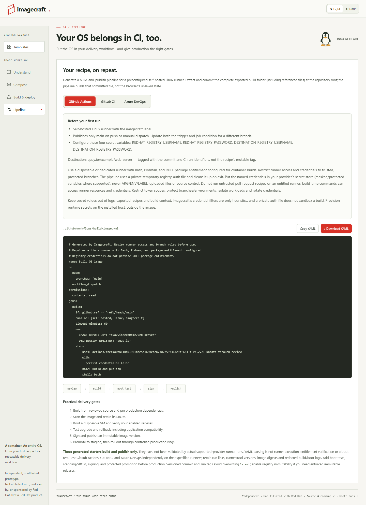

#  Imagecraft

**Build your RHEL image recipe, one step at a time.**

A friendly guide and workbench for choosing packages, adding files, and downloading a ready-to-review recipe. No account needed; nothing is uploaded.

**Independent and unaffiliated:** Imagecraft is not affiliated with, endorsed by, or sponsored by Red Hat. It is not a Red Hat product.



<details>
<summary>More previews</summary>

**Dark mode**



**Starter Library**



**Pipeline**



</details>

## ✨ Use it online

**[Open Imagecraft →](https://imagecraft.graa.dev/)**

1. Choose RHEL 9 or 10, or start with a template.
2. Add packages, commands, services, or local files; arrange them in order.
3. Review and download your Containerfile or a complete build folder. Save a portable recipe to continue in another browser.

Local files stay in memory. After reloading, select them again or import your saved portable recipe.

Imagecraft is a prototype that helps you write recipes—it does not build or run them. Review every download before using it. Building RHEL images needs your own RHEL access and a suitable build machine.

## 🏠 Run it yourself

With Podman installed:

```sh
podman run --rm -p 8080:8080 ghcr.io/erikgraa/imagecraft:edge
```

Open **[localhost:8080](http://localhost:8080)**. Docker works too—replace `podman` with `docker`.

`edge` is the newest development build. Numbered releases will have their own image tags and a stable `latest` tag; no numbered release has been published yet.

## 🧭 Follow along

[What's changed](CHANGELOG.md) · [Roadmap](ROADMAP.md) · [Report a problem](https://github.com/erikgraa/imagecraft/issues)
