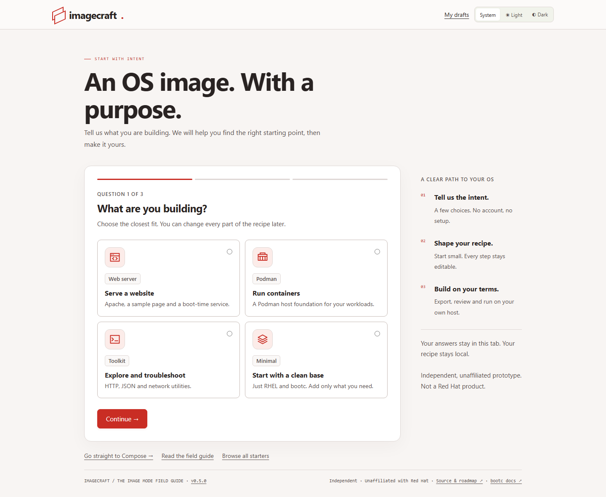
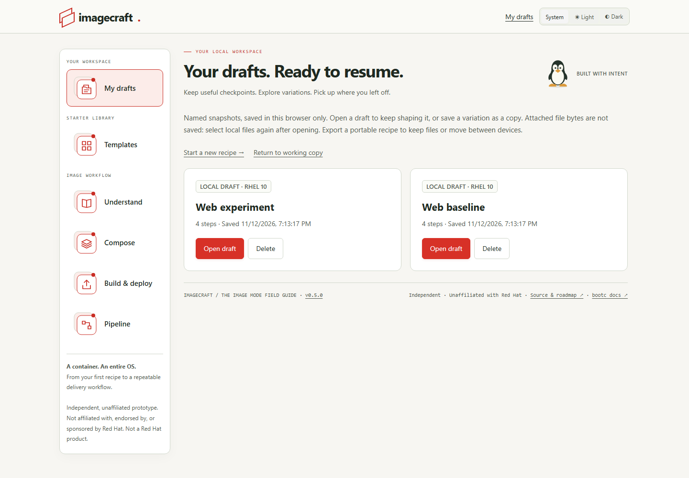
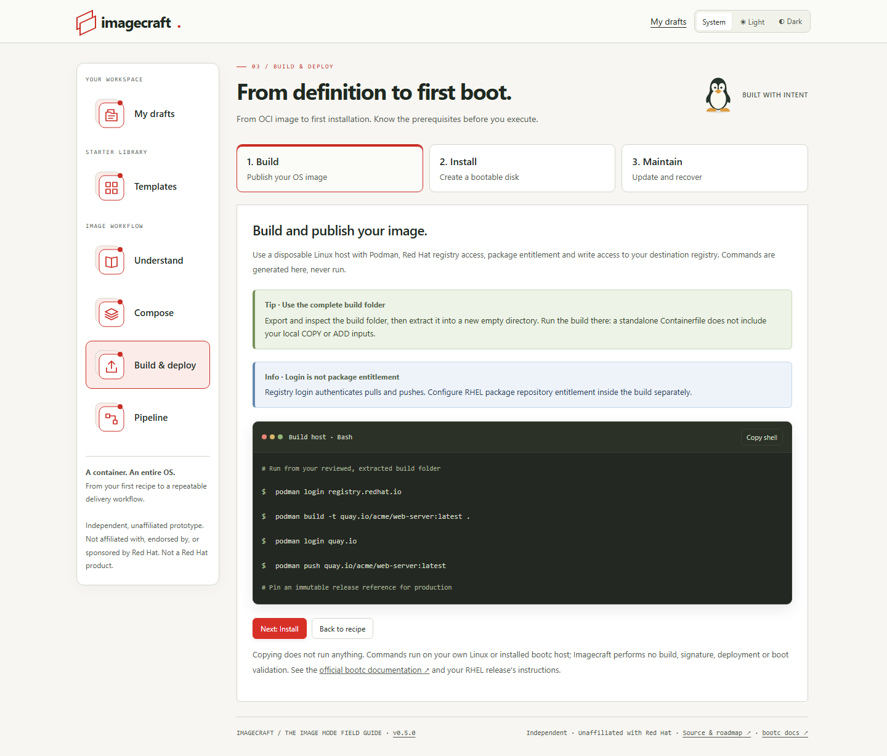

#  Imagecraft

**Built with intent. Your OS, composed.**

[](https://github.com/erikgraa/imagecraft/releases/tag/v0.5.0)
[](https://github.com/erikgraa/imagecraft/actions/workflows/delivery.yml)
[](#-run-it-yourself)
[](https://imagecraft.graa.dev/)

A friendly RHEL image-mode recipe workbench. Choose what you're building, compose a recipe, save local drafts, and download files to review on your own build host. **No account, no uploads, no builds in your browser.**

**Independent and unaffiliated:** Imagecraft is not affiliated with, endorsed by, or sponsored by Red Hat. It is not a Red Hat product.

## ✨ Get started

**[Open Imagecraft →](https://imagecraft.graa.dev/)**

1. Answer **“What are you building?”**, choose a RHEL release, and pick a destination. **RHEL 10 is recommended for new images**; RHEL 9 remains available.
2. Customize your starter in **Compose**: packages, commands, services, files, builder stages, and ordered Containerfile instructions.
3. **Save draft** to return later, or download a Containerfile, complete build folder, or portable recipe.
4. Follow **Build → Install → Maintain**, one task at a time. Each terminal copies its whole shell block, including caution comments; copying never runs it.

Explore [the field guide](https://imagecraft.graa.dev/?view=learn), [starter library](https://imagecraft.graa.dev/?view=templates), or [pipeline generator](https://imagecraft.graa.dev/?view=pipeline) directly. **System** is the default theme; Light and Dark are saved overrides.




<details>
<summary>📸 More screenshots: dark mode, drafts, starters, build, and pipelines</summary>








</details>

## 💾 Your work stays local

**My drafts** holds named snapshots, separate from working-copy autosave. Save updates explicitly, use **Save as copy** for a variation, or reopen/delete a snapshot. Opening asks before replacing your working copy; unfinished drafts are allowed, but exports require a valid recipe. Storage errors are shown without erasing existing snapshots.

Drafts have **no cross-device sync** and disappear if browser storage is cleared. Local file bytes stay in memory and are **not saved in drafts or autosave**: reselect files after reopening. Portable JSON and complete build-folder exports deliberately include referenced local file bytes; a standalone Containerfile does not.

## ⚠️ Review before you build

Version 0.5.0 releases the **workbench**, not validated OS images. Recipes, disk commands and provider workflows are illustrative; real RHEL builds, boot tests and runner validation are still outstanding. Building needs your own RHEL access and trusted, appropriately configured Linux hosts.

Never put credentials or private keys in recipes, attached files, or exports. Credential detection is incomplete. Review every download and command, especially privileged builds and reboot steps. The disk wizard generates commands/configuration—not a disk. OCI verification, disk signatures, bootc enforcement and Secure Boot are separate trust boundaries.

Prefer **COPY** for straightforward local files. **ADD** may download HTTPS files or unpack local tar archives **at build time**, never in Imagecraft; review provenance and contents on your build host. See the [field guide](https://imagecraft.graa.dev/?view=learn) and [validation guidance](CONTRIBUTING.md#external-validation-required-evidence-not-automated-claims).

## 🏠 Run it yourself

```sh
podman run --rm --read-only --cap-drop=ALL --security-opt=no-new-privileges \
  -p 8080:8080 ghcr.io/erikgraa/imagecraft:0.5.0
```

Open **[localhost:8080](http://localhost:8080)**. Docker works too—replace `podman` with `docker`. Images support Linux **amd64 and arm64**. Hosting Imagecraft needs no RHEL entitlement or server-side recipe storage; use a reverse proxy for public HTTPS.

`0.5.0` pins this workbench release. `latest` tracks numbered releases; `edge` tracks development on main. Image tags do not change the RHEL version of your recipe. [Build locally or configure hosting →](CONTRIBUTING.md#container-hosting)

## 🧭 Follow along

[Changelog](CHANGELOG.md) · [Roadmap](ROADMAP.md) · [Contribute](CONTRIBUTING.md) · [Report a problem](https://github.com/erikgraa/imagecraft/issues)

CI checks unit/browser/accessibility behavior and both container architectures before delivery to GitHub Pages and GHCR. Dependabot updates npm, Docker and GitHub Actions weekly. No license has been selected yet; no reuse rights are promised.
